# Bundle Lifecycle — Jig/Coupler/Engine/Bundle (scratch)

Not promoted to wiki. How a `SatchelBundle` moves through the lifecycle, and which layer --
Jig (`ASatchelJig`), Coupler (`AScopeCoupler`), Engine (`ScopeEngine_Server`), or the Bundle
itself -- drives each step. Server-side only. Redrawn 2026-09-10 against SAT_053, which landed
since the first version of this diagram.

**What changed under SAT_053** (this replaces the earlier version of this diagram, which showed
the pre-fix shape): `HYDRATED` is gone from `LifecycleState` entirely -- the enum is now just
`CONSTRUCTED, CREATED, LOADED, ACTIVE, DESTROYING, DESTROYED`. `hydrateFrom()` no longer performs
a lifecycle transition itself; it just applies fixtures and sets `isHydrated()`. Whether a bundle
even attempts hydration is now gated on a new **bundle-level** declaration --
`SatchelBundle.required()`, a `Capability` bitmask the bundle author overrides -- not on the old
jig-level `JigPolicies.Capabilities.requiresPersistence()` flag (renamed `allowsPersistence()`:
it now answers "does this jig allow it", a different question from "does this bundle need it").
A bundle that declares no requirements (`Capability.NONE`, the default) is promoted straight to
`ACTIVE` the instant it's created, no hydration wait at all.

This is the literal SAT_049 fix, and it lands without touching `SatchelHealth.java`: its three
tracking bundles are plain `new SatchelBundle(scope, KEY)` with no `required()` override, so
under the new model they promote immediately -- the engine-level conflation that stuck them in
`CREATED` forever is gone. `BordersBundle` and `BossBundle` now explicitly override
`required()` to `Capability.PERSISTENCE.bit()`, matching their jigs' `allowsPersistence()` flag.

One more real behavior change: `resolveServerLevel()` used to return `null` when a capability
wasn't required (silent skip). Now it never returns null -- if a bundle's `required()` claims a
capability its own jig doesn't `allow`, it throws `SatchelException.AccessFailed` immediately,
loudly, instead of silently no-op'ing. That's a real wiring-mistake-vs-jig-author contract, not
just a rename.

`Capability.NETWORKING` exists in the enum but isn't wired into `hydrateBundle()`/`flushIfDirty()`
gating yet -- only `PERSISTENCE` is checked today. Not shown as a live path below; noted as an
open SAT_053 question in the source comments.

Derived from: `Satchel/src/main/java/com/arryn/satchel/server/jig/guts/ScopeEngine_Server.java`
(`create`, `hydrateBundle`, `flushIfDirty`, `onJigTick`, `onExecutionPulse`, `unload`,
`resolveServerLevel`), `Satchel/src/main/java/com/arryn/satchel/common/bundle/SatchelBundle.java`
(`onCreated`, `hydrateFrom`, `onLoaded`, `onJigTick`, `onDestroyed`, `required`, `isHydrated`),
`Satchel/src/main/java/com/arryn/satchel/common/bundle/LifecycleState.java`/`LifecycleGuard.java`,
`Satchel/src/main/java/com/arryn/satchel/common/bundle/Capability.java` (new in SAT_053),
`Satchel/src/main/java/com/arryn/satchel/common/newconfig/newnew/JigPolicies.java` (`Capabilities`
record, renamed `requires*` -> `allows*`), `FrontierMode/.../border/common/bundle/BordersBundle.java`
and `FrontierMode/.../boss/common/bundle/BossBundle.java` (`required()` overrides),
`Satchel/src/main/java/com/arryn/satchel/common/tracking/SatchelHealth.java` (unchanged --
its tracking bundles are the ones this fix actually unblocks).

```mermaid
flowchart TD
    classDef jig fill:#0d4429,stroke:#3fb950,color:#c9d1d9
    classDef coupler fill:#4d2d00,stroke:#d29922,color:#c9d1d9
    classDef engine fill:#3c1e70,stroke:#a371f7,color:#c9d1d9
    classDef bundle fill:#161b22,stroke:#6e7681,color:#c9d1d9
    classDef state fill:#0d2847,stroke:#58a6ff,color:#ffffff,stroke-width:2px
    classDef error fill:#4d0000,stroke:#f85149,color:#ffdddd,stroke-width:2px

    Start(["Consumer code<br/>e.g. a ScopeEvent.Loaded handler"])
    J1["Jig: getOrCreate(scope, key)<br/>/ ask() / get()"]:::jig
    C1["Coupler: getOrCreate(info, key)<br/>tries get(info, key) first"]:::coupler
    E1["Engine: get(info, key)"]:::engine
    Found{"Bundle already present<br/>for this scope?"}
    Existing(["existing bundle returned"])
    NotFound["Coupler catches<br/>SatchelException.BundleNotFound --<br/>routine on first access, falls through"]:::coupler
    ECreate["Engine: create(info, key)"]:::engine
    NewBundle["Bundle: factory.create(scope)<br/>e.g. new BordersBundle(...)"]:::bundle
    StConstructed(("CONSTRUCTED")):::state
    ApplyFixtures["Engine: applyFixture() per FixtureDecl,<br/>registers bundle, attachSyncDelegate"]:::engine
    OnCreated["Bundle: onCreated()<br/>-- fixture.onCreated() each,<br/>markDirty() if server"]:::bundle
    StCreated(("CREATED")):::state
    HydrateCall["Engine: hydrateBundle(info, key, bundle)"]:::engine
    ReqCheck{"bundle.required() includes<br/>Capability.PERSISTENCE ?<br/>(SAT_053: bundle-declared, not jig-level)"}
    ResolveLevel["Engine: resolveServerLevel(PERSISTENCE) --<br/>returns the ServerLevel, or THROWS if<br/>the jig doesn't allow it"]:::engine
    HydrateFrom["Bundle: hydrateFrom(source) --<br/>real SavedData if present, else an<br/>explicit empty source. No transition;<br/>applies fixtures + sets isHydrated()"]:::bundle
    SkipHydrate["Nothing required --<br/>e.g. SatchelHealth's plain SatchelBundle<br/>(required() defaults to Capability.NONE)"]:::bundle
    ThrowNode[["SatchelException.AccessFailed --<br/>bundle/jig wiring mismatch, crashes loudly<br/>(was a silent skip before SAT_053)"]]:::error
    PromoteCheck{"still CREATED?<br/>(defensive guard, not a poll loop)"}
    OnLoadedCall["Bundle: onLoaded() --<br/>CREATED -> LOADED -> ACTIVE,<br/>same call, no gap;<br/>fixture.onLoaded() each"]:::bundle
    StActive(("ACTIVE")):::state
    TickLoop["Engine: onJigTick(info) -- per jig tick,<br/>for each bundle, skip unless<br/>lifeCycleState()==ACTIVE"]:::engine
    OnJigTickCall["Bundle: onJigTick()<br/>-- fixture.onJigTick() each"]:::bundle
    PulseLoop["Engine: onExecutionPulse(info) --<br/>pulseSync + healthCheckPulse per bundle,<br/>then flushIfDirty() if isDirty()"]:::engine
    DirtyCheck{"isDirty() and required()<br/>includes PERSISTENCE?"}
    Idle(["nothing to flush this pulse"])
    ResolveLevel2["Engine: resolveServerLevel(PERSISTENCE)<br/>(throws same as above if jig disallows)"]:::engine
    Store["Engine: SavedDataEgressSink.store(<br/>bundle.saveAll()); bundle.clearDirty()"]:::engine
    UnloadCall["Engine: unload(info) -- terminal flush<br/>via onExecutionPulse, then per bundle"]:::engine
    OnDestroyedCall["Bundle: onDestroyed()<br/>-- force DESTROYING, fixture.onRemoved()<br/>each, force DESTROYED"]:::bundle
    StDestroying(("DESTROYING")):::state
    StDestroyed(("DESTROYED")):::state

    Start --> J1 --> C1 --> E1 --> Found
    Found -- yes --> Existing
    Found -- no --> NotFound --> ECreate --> NewBundle --> StConstructed --> ApplyFixtures --> OnCreated --> StCreated
    StCreated --> HydrateCall --> ReqCheck
    ReqCheck -- "yes, e.g. Border, Boss" --> ResolveLevel
    ResolveLevel -- "jig allows" --> HydrateFrom
    ResolveLevel -- "jig doesn't allow" --> ThrowNode
    ReqCheck -- "no (default)" --> SkipHydrate
    HydrateFrom --> PromoteCheck
    SkipHydrate --> PromoteCheck
    PromoteCheck -- yes --> OnLoadedCall --> StActive
    PromoteCheck -- "no (already ACTIVE)" --> StActive
    StActive --> TickLoop --> OnJigTickCall
    StActive --> PulseLoop --> DirtyCheck
    DirtyCheck -- yes --> ResolveLevel2 --> Store
    DirtyCheck -- no --> Idle
    StActive --> UnloadCall --> OnDestroyedCall --> StDestroying --> StDestroyed
```

